<div align="center">

# ☀️ sun-align

**Компенсация межкадрового смещения и поворота изображений Солнца**

Центрирование диска с субпиксельной оценкой центра и поиск угла поворота по кольцевым профилям.
Ядро алгоритма на чистом NumPy, без «чёрных ящиков» OpenCV, чтобы его можно было перенести на бортовой вычислитель.


Студенческий проект программы [«Кадры для космоса»](https://кадрыдлякосмоса.рф)

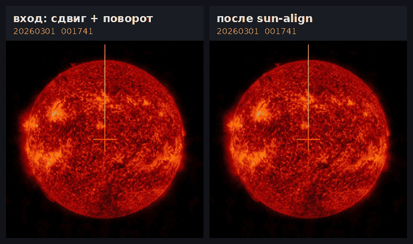

<sub>Слева кадры серии с дрейфом и поворотом, справа те же кадры после sun-align. Красный крест — центр кадра, жёлтая линия — неподвижное направление «вверх».</sub>

</div>

---

## Содержание

- [Задача](#задача)
- [Результаты](#результаты)
- [Как это работает](#как-это-работает)
- [Математика](#математика)
  - [1. Порог Оцу](#1-порог-оцу-отделяем-диск-от-фона)
  - [2. Центр диска по хордам](#2-центр-диска-по-хордам)
  - [3. Отбраковка кадров](#3-отбраковка-кадров)
  - [4. Целочисленный сдвиг](#4-целочисленный-сдвиг)
  - [5. Угол поворота: кольцевые профили](#5-угол-поворота-кольцевые-профили)
  - [6. Поворот и бикубическая интерполяция](#6-поворот-и-бикубическая-интерполяция)
- [Сравнение с альтернативами](#сравнение-с-альтернативами)
  - [Центрирование: sun-align против готовых функций OpenCV](#центрирование-sun-align-против-готовых-функций-opencv)
  - [Интерполяция: билинейная против бикубической](#интерполяция-билинейная-против-бикубической)
- [Метрики](#метрики)
- [Установка и запуск](#установка-и-запуск)
- [Настройки](#настройки)
- [Структура проекта](#структура-проекта)
- [Ограничения и развитие](#ограничения-и-развитие)

---

## Задача

Космический аппарат за сутки снимает несколько сотен кадров Солнца. Из-за дрейфа ориентации диск от кадра к кадру **смещается** и **поворачивается**, масштаб при этом не меняется. Чтобы изучать эволюцию активных областей, серию нужно выровнять:

1. выбрать опорный кадр (базу);
2. поставить центр диска каждого кадра в центр изображения с минимальной ошибкой;
3. найти угол поворота каждого кадра относительно базы и скомпенсировать его;
4. отбраковать кадры, где Солнце попало в кадр не целиком;
5. собрать метрики качества по каждому кадру и по серии.

**Главное требование:** алгоритм должен быть пригоден для переноса на бортовой компьютер. Поэтому всё, что определяет результат (порог, центр, угол, интерполяция, поворот), написано вручную на NumPy. OpenCV используется только для чтения и записи файлов и перевода в оттенки серого.

---

## Результаты

Тестовая серия: 12 снимков SDO/AIA 304 Å (1024×1024), снятых 1 марта 2026 года с 00:17 до 09:22. Кадры заранее сдвинуты примерно на 40 px, один выведен за край кадра. В тестовом режиме программа дополнительно поворачивает кадры на известные углы от −9,4° до 83°.

| Показатель | Значение |
|---|---|
| Обработано / отбраковано | **11 / 1** (диск обрезан сверху) |
| Сдвиг до центра: среднее / максимум | 26,4 / 38,9 px |
| Остаток после центрирования, максимум | **0,44 px** (теоретический предел 0,5 px) |
| Ошибка угла, среднее по модулю | **0,23°** |
| Ошибка угла, максимум | 1,12° (на угле 30,12°) |
| Систематический сдвиг угла | −0,18° |
| Стабильность радиуса диска (std) | 2,5 px из 404 px (0,6 %) |
| Время на кадр (Python, ноутбук) | ≈ 1 с |

<p align="center">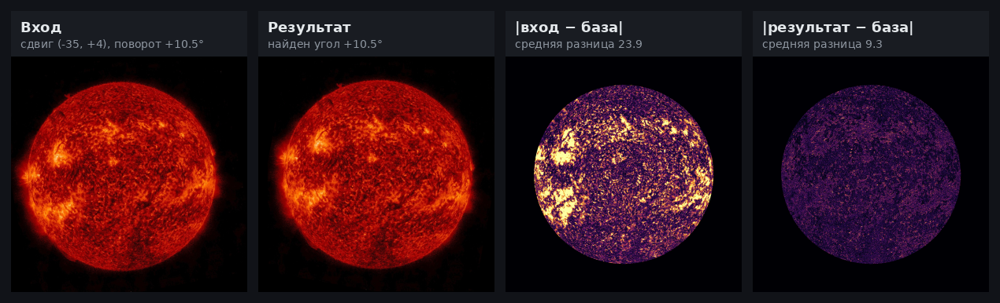</p>

<sub>Базовый кадр, сдвинутый на (−35, +4) px и повёрнутый на 10,5°, прошёл весь конвейер. Найден угол ровно +10,5°. Карты справа: модуль разности с базой внутри диска до и после выравнивания (×4 для наглядности). Остаточная разница 9,3 уровня яркости — это след двух интерполяций и субпиксельного остатка центрирования.</sub>

---

## Как это работает

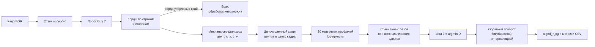

Кадры обрабатываются **потоком, по одному**. В памяти находятся только текущий кадр и профили базы (30 × 720 чисел ≈ 170 КБ). Промежуточные результаты не пишутся на диск и не пережимаются в JPEG, а сразу передаются следующему шагу.

---

## Математика

### 1. Порог Оцу: отделяем диск от фона

Цветной кадр переводится в яркость по стандарту ITU-R BT.601:

$$I = 0.299\,R + 0.587\,G + 0.114\,B$$

Затем нужен порог $t$, который делит пиксели на два класса: фон ($I \le t$) и диск ($I > t$). Метод Оцу выбирает порог, при котором классы **сильнее всего различаются**, то есть максимальна межклассовая дисперсия:

$$\sigma_B^2(t) = n_0(t)\, n_1(t)\, \bigl(\mu_0(t) - \mu_1(t)\bigr)^2, \qquad t^* = \arg\max_t \sigma_B^2(t)$$

где $n_0, n_1$ — число пикселей в классах, $\mu_0, \mu_1$ — их средние яркости.

Всё считается по гистограмме $h_i$ (256 значений) накопленными суммами: $n_0(t) = \sum_{i \le t} h_i$, $s_0(t) = \sum_{i \le t} i\,h_i$, $\mu_0 = s_0/n_0$, $\mu_1 = (S - s_0)/(N - n_0)$. Поэтому перебор всех порогов стоит **O(256)**, а не O(256·N). Если максимум достигается на плато, берётся его середина $(t_{low} + t_{high})/2$.

<p align="center">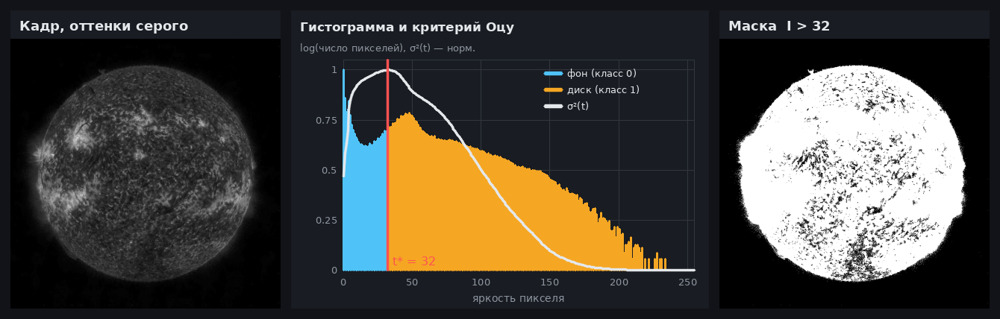</p>

<sub>Слева кадр в оттенках серого. В центре гистограмма (логарифмическая шкала) и кривая σ²(t), максимум которой даёт t* = 32. Справа маска I > t*.</sub>

### 2. Центр диска по хордам

**Ключевой геометрический факт:** у любой горизонтальной хорды окружности $(x - c_x)^2 + (y - c_y)^2 = R^2$ концы лежат в точках

$$x_{L,R} = c_x \mp \sqrt{R^2 - (y - c_y)^2},$$

поэтому её середина $\tfrac{x_L + x_R}{2} = c_x$ **при любом $y$**. То же для вертикальных хорд и $c_y$. Значит, центр можно найти по серединам хорд, без подгонки окружности и без итераций.

**Субпиксельный край.** Граница диска почти никогда не попадает точно на пиксель. Между соседними пикселями $x_1$ и $x_2 = x_1 + 1$ с яркостями $I_1 \le t < I_2$ яркость считается линейной, и точка пересечения с порогом равна

$$x_{edge} = x_1 + \frac{t - I_1}{I_2 - I_1}.$$

<p align="center">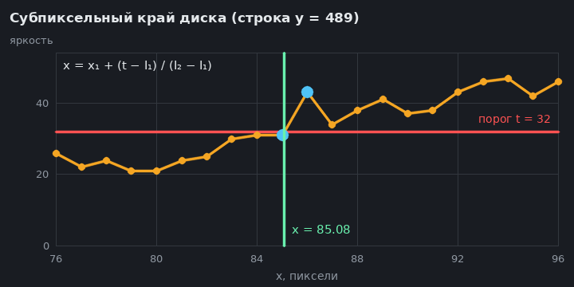</p>

**Медиана вместо среднего.** На краю диска бывают вспышки и протуберанцы, они удлиняют часть хорд. Поэтому центр берётся как **медиана** середин: она выдерживает до 50 % испорченных хорд, а среднее сдвигается от любой. Хорды короче половины самой длинной (у полюсов диска) отбрасываются: там край почти параллелен хорде, и шум на нём велик. Хорды берутся через каждые 8 строк и столбцов, это около 100 хорд на ось.

<p align="center">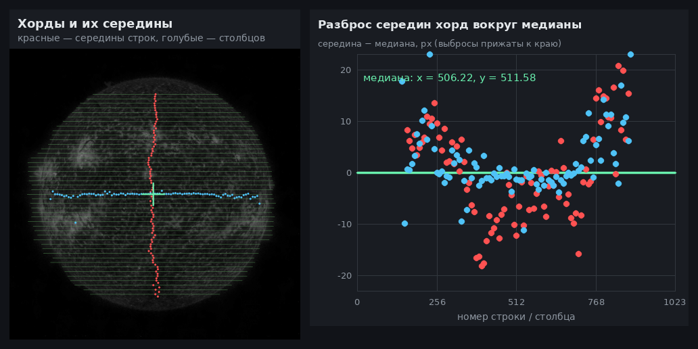</p>

<sub>Середины горизонтальных хорд (красные) выстраиваются в вертикаль x = cx, середины вертикальных (голубые) — в горизонталь y = cy. Справа их отклонение от медианы: на снимках 304 Å край диска неровный из-за короны и протуберанцев, и разброс середин доходит до ±20 px, но медиана от этого почти не страдает.</sub>

Почему не готовый `cv2.minEnclosingCircle`, с которого проект начинался (`test_center.py`)? Наименьшая описанная окружность целиком определяется **самыми крайними** точками контура. Одна вспышка на краю уводит её на десятки пикселей:

<p align="center">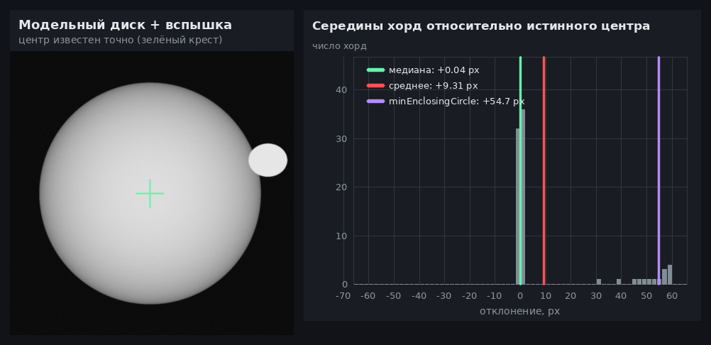</p>

<sub>Модельный диск с точно известным центром и вспышкой на краю. Медиана середин хорд: ошибка +0,04 px. Среднее: +9,3 px. Описанная окружность: +54,7 px.</sub>

**Радиус** нужен для колец (см. п. 5) и берётся из площади маски: $R = \sqrt{A / \pi}$, где $A$ — число пикселей ярче $t^*$.

### 3. Отбраковка кадров

Если часть диска за кадром, недостающий кусок неоткуда взять, и центр по хордам будет смещён. Признак простой: у целого диска по обоим концам каждой хорды фон. Если **две хорды подряд** начинаются или заканчиваются на краю кадра (`row[0] > t` или `row[-1] > t`), кадр отбраковывается с сообщением *«обработка невозможна: солнце за краем …»*. Одна такая хорда прощается: это может быть шум или вспышка. Проверка стоит два сравнения на хорду и прерывает разбор кадра сразу, не дочитывая его.

<p align="center">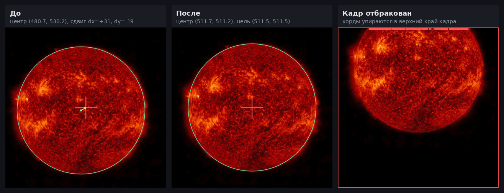</p>

<sub>Слева кадр до центрирования: найденный диск (зелёный), центр кадра (красный крест) и вектор сдвига. В центре результат. Справа отбракованный кадр, у которого хорды упираются в верхний край.</sub>

### 4. Целочисленный сдвиг

Цель — центр кадра $\left(\tfrac{W-1}{2}, \tfrac{H-1}{2}\right) = (511.5,\ 511.5)$ для 1024×1024. Пиксели нумеруются с 0, поэтому центр лежит между пикселями 511 и 512. Сдвиг

$$d_x = \mathrm{round}(x_t - c_x), \qquad d_y = \mathrm{round}(y_t - c_y)$$

выполняется копированием прямоугольного блока массива (срезами NumPy), без интерполяции, поэтому **кадр не теряет ни одного уровня яркости**. Остаток после сдвига по каждой оси не превышает 0,5 px. Это теоретический предел для целочисленного сдвига, и в тесте он равен 0,44 px.

### 5. Угол поворота: кольцевые профили

Диск — круг, поэтому ни контур, ни центр не меняются при повороте. Угол можно найти только по **узору** яркости: активные области, волокна, протуберанцы, корона.

**Развёртка.** Вокруг центра проводятся $K = 30$ окружностей радиусов $r_k = f_k R$: 12 по диску ($f = 0.70 \dots 0.95$) и 18 по короне ($f = 1.04 \dots 1.20$). Узкий пояс у самого края ($0.95 \dots 1.04$) пропускается: там яркость резко падает, малейшая ошибка центра даёт сильный шум, а информации об угле в круглом крае нет. На каждой окружности берётся $N = 720$ точек с шагом 0,5°:

$$P_k(j) = \ln\bigl(1 + I(c_x + r_k\cos\varphi_j,\ c_y - r_k\sin\varphi_j)\bigr), \qquad \varphi_j = \frac{2\pi j}{N}$$

- **Логарифм** сжимает динамический диапазон: яркие активные области не заглушают тусклую корону. $\ln(1 + I)$ вместо $\ln I$ нужен, чтобы не было $-\infty$ на чёрных пикселях.
- **Нормировка** $\hat P_k = (P_k - \bar P_k) / \sigma_{P_k}$ уравнивает вклад колец: важен узор, а не средняя яркость кольца.
- Значения в дробных точках берутся бикубической интерполяцией (п. 6).

**Ключевое свойство:** поворот изображения на угол $\theta$ — это **циклический сдвиг** каждой развёртки на $s = \theta N / 360$ отсчётов:

$$\hat P'_k(j) = \hat P_k(j - s)$$

<p align="center">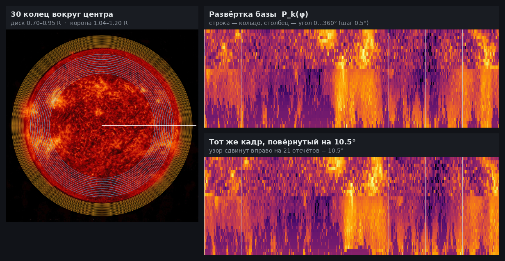</p>

<sub>Слева 30 колец на диске и в короне. Справа развёртки P̂ₖ(φ) базы и того же кадра, повёрнутого на 10,5°: весь узор сдвинут вправо на 21 отсчёт.</sub>

**Поиск сдвига.** Для каждого из $N$ циклических сдвигов считается расстояние между развёртками кадра и базы (норма $L_1$):

$$D(s) = \sum_{k=1}^{K}\sum_{j=0}^{N-1} \bigl|\hat P'_k(j) - \hat P_k(j - s)\bigr|, \qquad s^* = \arg\min_s D(s)$$

Сдвиг переводится в диапазон $(-N/2,\ N/2]$, так как сдвиг на 710 отсчётов — это то же, что на −10, и затем в градусы: $\theta = s^* \cdot 360 / N$.

<p align="center">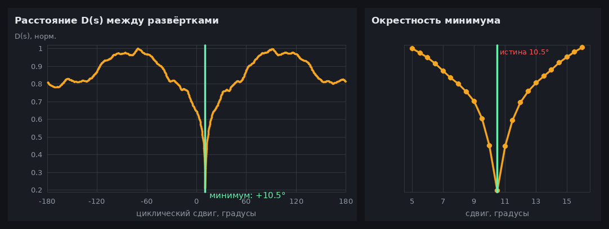</p>

<sub>D(s) для кадра, повёрнутого на 10,5°: один чёткий глобальный минимум ровно на +10,5°.</sub>

> **Связь с корреляцией.** Для нормированных профилей квадрат нормы $L_2$ и коэффициент корреляции Пирсона связаны как $\lVert a - b\rVert_2^2 = 2N(1 - \rho)$. Поэтому минимум $L_2$ — это ровно максимум корреляции. Норма $L_1$ ведёт себя так же, но слабее реагирует на отдельные выбросы (вспышки, следы частиц).

Разрешение по углу равно шагу сетки 0,5°, ошибка дискретизации до ±0,25°.

### 6. Поворот и бикубическая интерполяция

**Обратное отображение.** Если переносить пиксели исходника в новые места, в результате появятся дыры и наложения. Поэтому для **каждого пикселя результата** $(x, y)$ вычисляется, откуда он пришёл:

$$\begin{pmatrix} u_s \\ v_s \end{pmatrix} = \begin{pmatrix} \cos\theta & \sin\theta \\ -\sin\theta & \cos\theta \end{pmatrix} \begin{pmatrix} x - x_c' \\ -(y - y_c') \end{pmatrix}, \qquad x_s = x_c + u_s, \quad y_s = y_c - v_s$$

Минус у $v$ переводит экранную ось $y$ (вниз) в математическую (вверх), и положительный угол означает поворот против часовой стрелки. Центр поворота $(x_c, y_c)$ и место, куда он попадает, $(x'_c, y'_c)$, задаются отдельно, поэтому поворот и перенос можно выполнить за **одну** интерполяцию. Все координаты считаются сразу для всего кадра через `np.meshgrid`, без циклов по пикселям.

**Бикубическая интерполяция (ядро Кейса).** Точка $(x_s, y_s)$ дробная, и её яркость собирается из 16 соседей $4 \times 4$:

$$I(x_s, y_s) = \sum_{j=-1}^{2}\sum_{i=-1}^{2} W(f_x - i)\, W(f_y - j)\, I(x_0 + i,\ y_0 + j)$$

$$W(x) = \begin{cases} (a+2)|x|^3 - (a+3)|x|^2 + 1, & |x| \le 1 \\ a|x|^3 - 5a|x|^2 + 8a|x| - 4a, & 1 < |x| < 2 \\ 0, & |x| \ge 2 \end{cases} \qquad a = -0.75$$

где $x_0 = \lfloor x_s \rfloor$, $f_x = x_s - x_0$. Свойства ядра: $W(0) = 1$ и $W(\pm 1) = W(\pm 2) = 0$, то есть в узлах сетки значения не искажаются. Сумма весов равна 1, и $W$ непрерывно дифференцируемо. Отрицательные «лепестки» при $1 < |x| < 2$ подчёркивают перепады, поэтому края остаются резче, чем у билинейной интерполяции.

<p align="center">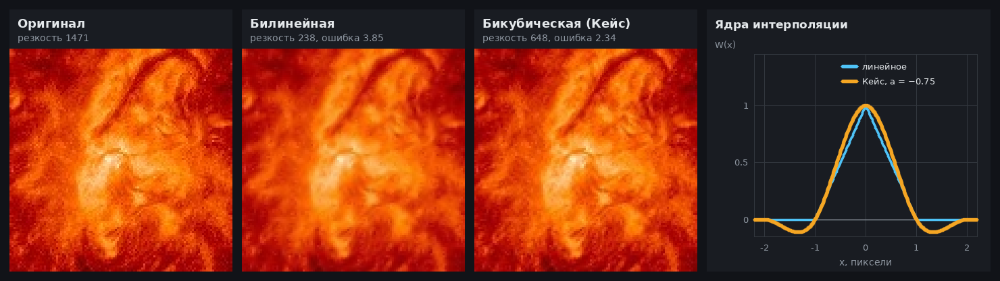</p>

<sub>Фрагмент активной области после поворота на 8,3° туда и обратно. Резкость (дисперсия лапласиана): оригинал 1471, билинейная 238, бикубическая 648. Средняя ошибка: 3,85 и 2,34 уровня яркости соответственно. Справа сравнение ядер.</sub>

---

## Сравнение с альтернативами

Чтобы проверить, оправдана ли ручная реализация, оба более простых решения из истории проекта прогнаны на тех же 12 кадрах.

### Центрирование: sun-align против готовых функций OpenCV

Первый прототип (`test_center.py`) собран из готовых функций OpenCV:

```text
GaussianBlur 5×5 → threshold(OTSU) → findContours → minEnclosingCircle → warpAffine (дробный сдвиг)
```

**Как мерили.** Истинный центр Солнца на реальном снимке неизвестен. Зато известно, на сколько пикселей каждый тестовый кадр сдвинут относительно исходного снимка (исходные снимки есть в истории репозитория, сдвиги целые, без интерполяции). Поэтому ошибка метода считается так:

$$e = (\mathbf c_{\text{сдвинутый}} - \mathbf c_{\text{исходный}}) - \mathbf d_{\text{известный}}$$

Она показывает, насколько точно метод отслеживает реальное смещение диска, независимо от того, где «настоящий» центр.

| | OpenCV (`test_center.py`) | sun-align |
|---|---|---|
| Ошибка восстановления сдвига, среднее | 1,55 px | **0,63 px** |
| Ошибка восстановления сдвига, максимум | 6,08 px | **2,00 px** |
| Вспышка на краю (модельный диск) | +54,7 px | **+0,04 px** |
| Обрезанный кадр | обработан молча, «центр» (495.5, 278.5) | **отбракован** |
| Резкость после центрирования | 33 % от исходной | **100 %** |
| Время поиска центра | **3 мс** | 44 мс |

<p align="center">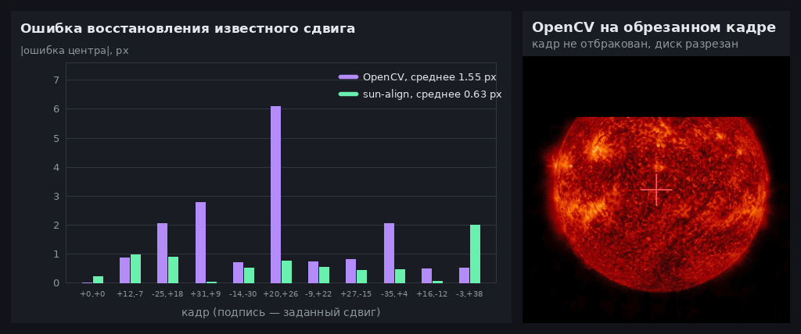</p>

<sub>Слева ошибка по каждому кадру (подпись — заданный сдвиг): фиолетовым OpenCV, зелёным sun-align. Справа то, что OpenCV делает с обрезанным кадром: «центрирует» разрезанный диск, не сообщая об ошибке.</sub>

**Почему так получается:**

- **`minEnclosingCircle` определяется 2–3 крайними точками контура.** На снимках 304 Å край диска неровный из-за протуберанцев и короны, и от кадра к кадру меняется именно то, какие точки «крайние». Отсюда скачки до 6 px. Медиана по ~100 хордам с каждой оси опирается на весь край сразу, и отдельный выступ её не сдвигает.
- **`warpAffine` сдвигает на дробное число пикселей** с билинейной интерполяцией (по умолчанию `INTER_LINEAR`). Каждый пиксель результата становится средним четырёх соседей, и резкость падает втрое. Целочисленный сдвиг просто копирует пиксели и не теряет ничего. Плата за это — остаток до 0,5 px.
- **Нет проверки на край.** `findContours` честно находит контур обрезанного диска, окружность строится по нему, и кадр уходит дальше с неверным центром.
- **OpenCV быстрее в 14 раз**, потому что внутри C++ с векторизацией, а у sun-align циклы на Python. В переносе на C разница исчезнет, а зависимость от OpenCV на борту не нужна.

> В исходном виде `test_center.py` ищет только файлы `*.png` и выравнивает кадры к центру Солнца на первом кадре, а не к центру изображения. Для сравнения взяты его функции поиска центра и сдвига, без изменения логики.

### Интерполяция: билинейная против бикубической

До коммита `585367b` поворот и снятие профилей использовали билинейную интерполяцию `sample()`. Каждый проход заметно размывал изображение, поэтому её заменили на бикубическую `sample_cubic()` с ядром Кейса. Сравнение проведено двумя экспериментами.

**1. Чистый эффект интерполяции.** Базовый кадр поворачивается на +8,3° и обратно $n$ раз подряд, без центрирования и поиска угла. Любое отличие от оригинала здесь вносит только интерполяция.

| Циклов «+8,3° → −8,3°» | Резкость, билинейная | Резкость, бикубическая | Ошибка \|Δ\|, билинейная | Ошибка \|Δ\|, бикубическая |
|---|---|---|---|---|
| 1 | 16 % | **44 %** | 3,86 | **2,35** |
| 3 | 4,5 % | **28 %** | 5,65 | **3,54** |
| 10 | 1,3 % | **23 %** | 7,28 | **5,08** |

<p align="center">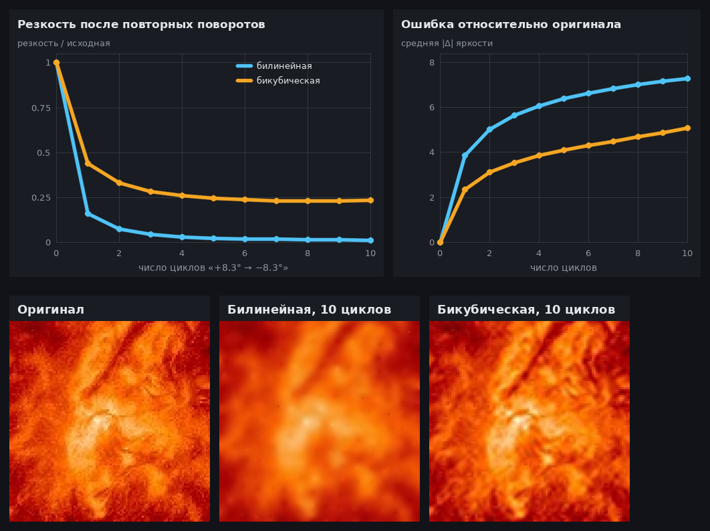</p>

<sub>Сверху резкость (дисперсия лапласиана относительно оригинала) и средняя ошибка яркости в зависимости от числа циклов. Снизу один и тот же фрагмент активной области: оригинал и результат после 10 циклов.</sub>

**2. Полный конвейер на 10 повёрнутых кадрах.** Тот же `main.py`, меняется только функция интерполяции.

| | Билинейная | Бикубическая |
|---|---|---|
| Ошибка угла, среднее \|e\| | 0,15° | 0,25° |
| Ошибка угла, максимум | 0,62° | 1,12° |
| Резкость результата относительно эталона | 12 % | **37 %** |
| PSNR относительно эталона | 27,0 дБ | 26,2 дБ |
| Время на кадр | **0,4 с** | 1,1 с |

<p align="center">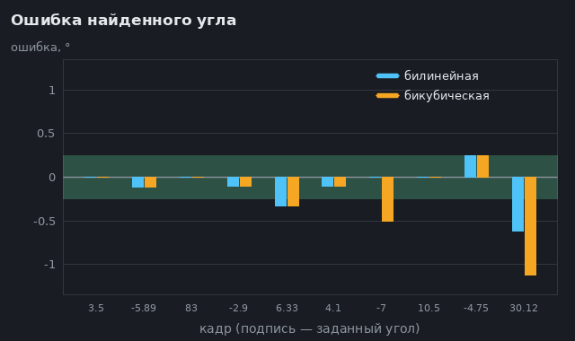</p>

**Почему билинейная размывает.** Билинейная интерполяция — это взвешенное среднее двух соседей по каждой оси. Сильнее всего она сглаживает, когда точка попадает ровно посередине между пикселями (сдвиг 0,5): тогда берётся простое среднее $\tfrac12 I_0 + \tfrac12 I_1$. Частотная характеристика такого фильтра

$$H_{\text{лин}}(f) = \cos(\pi f),$$

где $f$ — пространственная частота в периодах на пиксель (0 … 0,5). У ядра Кейса при том же сдвиге веса равны $(-0.094,\ 0.594,\ 0.594,\ -0.094)$, и

$$H_{\text{куб}}(f) = 2\bigl(0.594\cos(\pi f) - 0.094\cos(3\pi f)\bigr).$$

| Частота $f$, период/пиксель | 0,125 | 0,25 | 0,375 | 0,5 |
|---|---|---|---|---|
| Билинейная | 0,92 | 0,71 | 0,38 | 0 |
| Бикубическая | 1,02 | **0,97** | **0,63** | 0 |

На частоте 0,25 (деталь размером 4 пикселя: волокна, края ярких узлов) бикубическая сохраняет 97 % контраста, а билинейная только 71 %. Отрицательные веса на дальних соседях частично компенсируют сглаживание ближних.

При каждом новом проходе спектр снова умножается на $H(f)$, поэтому после $n$ проходов остаётся $|H(f)|^n$. У билинейной это $0.71^n$ на частоте 0,25: после 10 проходов около 3 %, и изображение продолжает «таять». У бикубической $0.97^n \approx 74\,\%$. Она теряет в основном самые высокие частоты (пиксельный шум и артефакты JPEG), а средние почти не трогает, поэтому резкость выходит на полку около 23 %.

**Почему угол при этом не стал точнее.** Угол ищется по 30 нормированным профилям длиной 720 точек, сразу по всей окружности. Сглаживание меняет мелкие детали профиля, но не сдвигает положение минимума $D(s)$. Точность ограничена шагом сетки 0,5° и шумом центра, а не интерполяцией. Две версии разошлись только на двух кадрах из десяти (−7° и 30,12°), где минимум лежит почти посередине между соседними узлами сетки. На такой выборке это шум, а не закономерность.

**Почему PSNR у билинейной даже немного выше.** Эталон — тот же кадр, просто отцентрированный без поворотов. Центр на повёрнутом и неповёрнутом кадре находится с разбросом около 0,5–1 px, поэтому результат и эталон чуть смещены друг относительно друга. При таком смещении метрики MSE и PSNR штрафуют каждую резкую деталь, попавшую не в тот пиксель, и размытое изображение получает меньший штраф. Поэтому качество интерполяции проверяется первым экспериментом, где смещения нет совсем.

**Вывод:**
- для итогового изображения бикубическая интерполяция однозначно лучше: почти втрое больше деталей за один проход и в 1,6 раза меньше ошибка;
- для кольцевых профилей её точность не нужна: можно вернуть там билинейную и ускорить поиск угла без потери точности;
- главное правило — **минимум интерполяций на кадр**. Поэтому в sun-align центрирование делается целочисленным сдвигом без интерполяции, а поворот — одним проходом.

---

## Метрики

Каждый запуск пишет две таблицы в `metrics/` (UTF-8 с BOM, открываются в Excel):

**`frames.csv`** — одна строка на кадр:

| Поле | Смысл |
|---|---|
| `file`, `hours` | имя кадра и время от базы (из имени файла `YYYYMMDD_HHMMSS_…`) |
| `center_x`, `center_y` | найденный центр диска |
| `dx`, `dy` | применённый сдвиг, px |
| `after_x`, `after_y` | центр после сдвига |
| `radius`, `threshold` | радиус диска и порог Оцу |
| `angle` | найденный угол относительно базы, ° |
| `ms` | время обработки кадра |
| `expected`, `error` | только в тестовом режиме: заданный угол и ошибка |

**`summary.csv`** — сводка по серии, печатается в конце работы: сколько кадров обработано и отбраковано, средний и максимальный сдвиг, остаток центрирования, разброс и скачки центра между соседними кадрами, **дрейф центра (px/ч)** и **скорость поворота (°/ч)** (наклон прямой МНК по времени съёмки), стабильность радиуса, время и ошибка угла.

<p align="center">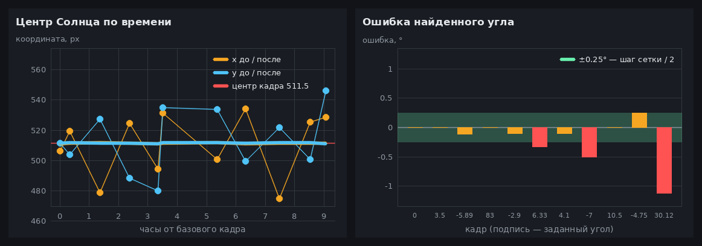</p>

<sub>Слева: центр диска по времени до выравнивания (точки) и после (жирные линии на 511,5 px). Справа: ошибка найденного угла по кадрам. Зелёная полоса ±0,25° — предел, задаваемый шагом сетки.</sub>

---

## Установка и запуск

Требуется Python 3.10+.

```bash
git clone https://github.com/caffreyfizz/sun-align.git
cd sun-align

python -m venv .venv
source .venv/bin/activate          # Windows: .venv\Scripts\activate
pip install numpy opencv-python

python main.py
```

Пример вывода:

```text
20260301_003729_aia304.jpg
  цель:          (511.50, 511.50)
  было:          (519.23, 503.76)
  сдвиг:         dx=-8, dy=+8
  стало:         (511.23, 511.76)
  угол:          +3.50° (задано +3.50°, ошибка +0.00°)
  время:         1067 мс
...
20260301_043729_aia304.jpg: обработка невозможна
...
============================================================
Общие метрики серии
============================================================
обработано                                         11
остаток после сдвига (по оси), максимум         0.444 px
ошибка угла, среднее |e|                        0.228 °
...
```

Результат:

- `aligned_pictures/algnd_<имя>.jpg` — выровненные кадры;
- `metrics/frames.csv`, `metrics/summary.csv` — метрики.

---

## Настройки

Все параметры собраны в начале `main.py`. Пути строятся от папки скрипта, поэтому запускать можно из любого каталога.

| Константа | По умолчанию | Назначение |
|---|---|---|
| `INPUT_DIR` | `pictures/` | входные кадры (`.jpg`, `.jpeg`, `.png`, по имени) |
| `ALIGNED_DIR` | `aligned_pictures/` | выровненные кадры |
| `CENTERED_DIR` | `None` | промежуточные отцентрированные кадры (PNG); `None` — не сохранять |
| `METRICS_DIR` | `metrics/` | CSV с метриками |
| `CENTERED_PREFIX`, `ALIGNED_PREFIX` | `cntrd_`, `algnd_` | приставки к именам файлов |
| `N_POINTS` | `720` | точек на кольце, задаёт шаг угла 360°/N = 0,5° |
| `RINGS` | 12 + 18 колец | радиусы колец в долях радиуса Солнца |
| `TEST_ANGLES` | список углов | тестовый режим: кадры заранее поворачиваются на известные углы, и печатается ошибка; `None` — рабочий режим |
| `TIME_FORMAT` | `%Y%m%d_%H%M%S` | формат времени съёмки в начале имени файла |

---

## Структура проекта

```text
sun-align/
├── main.py              # конвейер: настройки, цикл по кадрам, печать, метрики
├── solar_center.py      # порог Оцу, центр по хордам, отбраковка, целочисленный сдвиг
├── solar_rotation.py    # бикубическая интерполяция, поворот, кольцевые профили, угол
├── test_center.py       # первый прототип на OpenCV (Оцу + minEnclosingCircle) — для сравнения
├── pictures/            # входные кадры (сдвинутые для теста)
├── aligned_pictures/    # результат
├── metrics/             # frames.csv, summary.csv
└── docs/img/            # рисунки README
```

| Функция | Модуль | Что делает |
|---|---|---|
| `find_otsu_threshold(gray)` | `solar_center` | порог Оцу, центр, радиус → `(cx, cy, t, R)` или `None` |
| `find_center_x / _y(img, t)` | `solar_center` | середины хорд по строкам / столбцам с отбраковкой |
| `shift_image(img, dx, dy)` | `solar_center` | сдвиг на целое число пикселей срезами |
| `cubic_weights`, `sample_cubic` | `solar_rotation` | ядро Кейса и бикубическая выборка в дробных точках |
| `rotate(img, θ, center, new_center)` | `solar_rotation` | поворот с переносом за одну интерполяцию |
| `ring_profiles(gray, sun, N, RINGS)` | `solar_rotation` | матрица развёрток 30 × 720 |
| `pair_angle(base, image, N)` | `solar_rotation` | угол по минимуму расстояния D(s) |
| `center_frame`, `summarize` | `main` | центрирование кадра и сводные метрики |

---

## Ограничения и развитие

- **Шаг угла 0,5°.** Его можно уточнить параболой по трём точкам вокруг минимума $D(s)$ и получить точность меньше шага сетки без увеличения $N$.
- **Неровный край на 304 Å.** При пороге около 30 в маску попадают корона и протуберанцы, и середины хорд разбросаны на ±20 px. Медиана держит центр, но в отдельных кадрах ошибка доходит до 1–3 px. Можно попробовать сглаживание перед порогом или порог по профилю потемнения к краю.
- **Скорость.** Около 1 с на кадр в Python, основное время уходит на бикубическую интерполяцию и перебор 720 сдвигов. На C это будут миллисекунды. Перебор сдвигов в варианте $L_2$ заменяется БПФ: $O(N \log N)$ вместо $O(N^2)$.
- **Эволюция Солнца.** За сутки активные области заметно меняются и смещаются из-за собственного вращения Солнца (≈ 13°/сутки). Для длинных серий лучше сравнивать кадр не с одной базой, а со скользящей базой или с несколькими опорными кадрами.
- **Большие углы.** На 30° ошибка выросла до 1,1°. Вероятная причина: при большом повороте углы кадра уходят в чёрное, и внешние кольца короны частично теряют данные. Реальный дрейф ориентации обычно гораздо меньше.

---

<div align="center">

**Авторы:** Никита Юсько ([@caffreyfizz](https://github.com/caffreyfizz)) — центрирование, отбраковка, конвейер и метрики · [@MolecularBicycle](https://github.com/MolecularBicycle) — поиск угла и поворот

Изображения Солнца: NASA/SDO и научная группа AIA.

</div>
